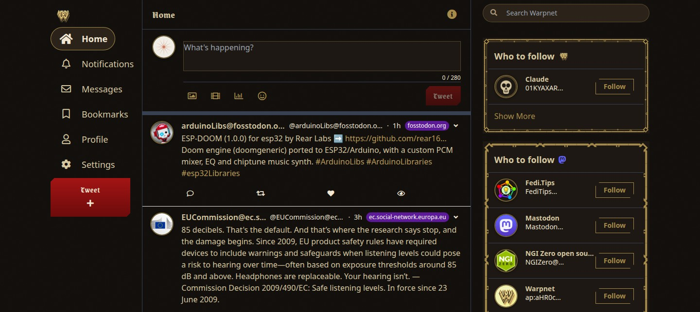

<div align="center">

# Warpnet

### A social network with no servers, no instances, and no company in the middle.

Warpnet is a fully decentralized, peer-to-peer social network built in Go. Every user runs a node. The node *is* the network. There is no central server to seize, no instance admin to trust, and no relay that holds your posts.

[](https://golang.org/dl/)
[](https://github.com/Warp-net/warpnet/blob/main/LICENSE.md)
[](https://github.com/Warp-net/warpnet/actions/workflows/build.yaml)
[](https://codecov.io/github/Warp-net/warpnet)
[](https://snapcraft.io/warpnet)
[](https://t.me/warpnetdev)
[](#contributing)
[](https://gitgem.org/github/Warp-net/warpnet)

[**Download**](https://warpnet.site/download) · [**Docs**](https://warp-net.github.io/docs/) · [**Build from source**](#build-from-source-developers) · [**How it works**](#how-it-works) · [**Contributing**](#contributing)

<a href="docs/img/screenshot.jpg">
  
</a>
</div>

---

## Table of Contents

- [Why Warpnet exists](#why-warpnet-exists)
- [What makes it different](#what-makes-it-different)
- [Features](#features)
- [Quick start (users)](#quick-start-users)
- [Build from source (developers)](#build-from-source-developers)
- [How it works](#how-it-works)
- [Project layout](#project-layout)
- [Contributing](#contributing)
- [FAQ](#faq)
- [Community](#community)
- [License](#license)

---

## Why Warpnet exists

Every "decentralized" social network you've heard of still has a soft center.

- **Federated networks** (like Mastodon) still put you on an *instance*. The instance admin holds your data, sets the rules, can defederate from others, and can simply shut the server down. You traded one landlord for thousands of smaller ones.
- **Relay server based networks** (like Nostr) make the client thin and push storage onto *relays* — stateful servers that can rate-limit you, refuse your events, or delete your data.
- **"Protocol" networks** (like the atproto ecosystem) decentralize in theory but concentrate around a handful of large providers in practice.

Warpnet takes the harder road on purpose: **there is no server tier at all.** Each participant runs a node that stores its own data locally and talks directly to other nodes. Peers are found through a DHT, gossip and mDNS, every connection is encrypted with the Noise protocol, and posts travel from the author's node straight to the followers' nodes. There is nothing in the middle to capture, subpoena, or switch off.

That's a real engineering challenge — and that's exactly why it's interesting to build.

## What makes it different

A fair comparison, because the alternatives are good projects making different tradeoffs:

| | **Warpnet** | Mastodon | Nostr | Bluesky / atproto |
|---|:---:|:---:|:---:|:---:|
| Architecture | True P2P (libp2p) | Federated instances | Client + relay server | PDS + relays |
| Server required? | **None** | Yes (instance) | Yes (relay servers) | Yes (providers) |
| Where your data lives | **Your own node** | Instance admin's DB | Relay servers you post to | Your PDS provider |
| Transport security | **Noise protocol** | TLS to instance | TLS to relay server | TLS to provider |
| Can an admin deplatform you? | **No admin exists** | Yes (instance admin) | Relay server can drop you | Provider can drop you |
| Discovery | **DHT, gossip, mDNS** | Instance + relay routers | Relay server lists | Relays / indexers |
| Moderation | LLM moderator nodes vote | Per-instance | Per-client | Labelers |

Warpnet's bet: the only way to be genuinely censorship-resistant is to remove the server entirely, not to multiply it.

## Features

- **Serverless by design** — no instances, no central database. Nodes connect directly over [libp2p](https://libp2p.io/). A node behind NAT tries hole punching and otherwise reaches others through a circuit relay on one of its bootstrap nodes. Relay nodes store nothing on disk.
- **Encrypted everywhere** — every connection is gated by a network key (PSK) and encrypted with the **Noise protocol**, inside a TLS layer that looks like ordinary HTTPS to deep packet inspection — see [Network](https://warp-net.github.io/docs/network.html).
- **Local-first storage** — your profile, posts, follows and chats live in an encrypted embedded database on *your* machine.
- **Censorship-resistant** — posts travel from the author's node to followers' nodes over gossip and direct streams; there's no single point that can be blocked.
- **One protocol, every client** — the desktop app (Wails + Vue), a browser dashboard for a headless node, and the Android ([Tusky](https://github.com/tuskyapp/Tusky) fork) and iOS ([Ice Cubes](https://github.com/Dimillian/IceCubesApp) fork) apps all reach the same handlers on your node. The phone apps hold no account of their own: they pair with your node.
- **Decentralized moderation** — volunteer moderator nodes judge each report with a local model (Llama Guard 3) and vote. A verdict needs at least three signed votes and a strict majority, and every node recounts the votes before applying it. No human reviews reports — see [Moderation](https://warp-net.github.io/docs/moderation.html).
- **Cross-platform** — Windows, Linux, macOS, Android and iOS.
- **Fully open source** — the node, the desktop UI and the Android app are AGPLv3; the iOS app is Apache 2.0.

## Quick start (users)

Download the desktop app from **[warpnet.site/download](https://warpnet.site/download)**: Windows, Linux (x86-64 and ARM64), macOS and the Android APK. The files come from the [latest GitHub release](https://github.com/Warp-net/warpnet/releases/latest). On Linux you can also install the Snap, published on the beta channel:

```bash
sudo snap install warpnet --beta
warpnet
```

[](https://snapcraft.io/warpnet)
<a href="https://f-droid.org/packages/site.warpnet.warpdroid/"></a>

The iOS app is on the [App Store](https://apps.apple.com/app/warpnet/id6835178022). Phone apps pair with a running desktop app (or a headless remote node) by scanning its QR code — see [Mobile apps](https://warp-net.github.io/docs/user-guide/mobile.html).

The macOS build is not signed: try to open `warpnet.app` once, then allow it in **System Settings → Privacy & Security → Open Anyway**.

On first launch you choose a network and create an account with a **login** and a **password**. Together with the network name they derive your node's key, so **your login and password are your identity**: change or lose either and you get a different node, and your existing database no longer opens. There is no reset. The login is not your profile name (that starts as "Anonymous" and is edited separately) and is never published. The node then connects to the nodes in its bootstrap list and finds further peers. That's it — you're a node.

More in [Getting started](https://warp-net.github.io/docs/user-guide/).

### Networks

Warpnet runs separate networks that cannot see each other. Use the testnet to experiment without affecting real data:

```bash
warpnet --node.network testnet   # safe playground
warpnet --node.network warpnet   # the live network (the default; "mainnet" is accepted too)
```

## Build from source (developers)

### Prerequisites

- [Go 1.26.3+](https://go.dev/doc/install)
- [Wails CLI v2.10.2](https://github.com/wailsapp/wails) (for the desktop node): `go install github.com/wailsapp/wails/v2/cmd/wails@v2.10.2`

### Run a member node with the desktop UI

```bash
sudo apt update
sudo apt install -y build-essential libgtk-3-dev libwebkit2gtk-4.1-dev
cd cmd/node/member # pick the member node dir
wails build -m -nosyncgomod -devtools -tags webkit2_41 # compile a binary
./build/bin/warpnet --node.network testnet # run binary on a testnet
```

The binary embeds the committed UI bundle `frontend/dist`. After changing `frontend/src`, run `make frontend` and rebuild. Building the relay, the moderator, the headless remote node with its browser dashboard, and the Android and iOS apps is covered in the [Developer Guide](https://warp-net.github.io/docs/developer-guide/).

> **Heads up:** don't edit the `version` file by hand. The `pre-commit` hook in `.githooks/` (enable it with `make setup-hooks`) bumps the patch version on every commit to `main` and `develop` and keeps `snap/snapcraft.yaml` and the app manifests in step. The **Release** workflow only builds an existing tag.

## How it works

Warpnet has three node types:

| Type | What it does |
|---|---|
| **member** | The user's node: holds the account in an encrypted local database, serves the UI and paired phones, publishes and receives posts. Also builds as a headless **remote** node with a browser dashboard. |
| **relay** | Headless infrastructure node on a public address: DHT server, circuit relay for nodes behind NAT, gossip forwarding. Keeps everything in memory. |
| **moderator** | Runs Llama Guard 3 locally and votes on reported content with other moderators. |

**A bootstrap node is not a node type.** It is any address in a node's bootstrap list: the first peers the node dials, the seed of its DHT routing table, and the only relays it reserves circuit relay slots on when it is behind NAT. The built-in lists for `warpnet` and `testnet` point at three relay nodes run by the project; `--node.bootstrap` replaces them. See [Architecture](https://warp-net.github.io/docs/architecture.html#bootstrap-nodes).

### One protocol, every client

Every client reaches the *same* canonical handler on your member node. They only differ in how the request gets there:

```
              ┌────────────────────────────────────┐
              │          your member node          │
              │  cmd/node/member/...               │
              │  core/handler/<feature>.go         │  ← ONE canonical handler per route
              │  database/<feature>-repo.go        │
              └────▲─────────────▲─────────────▲───┘
                   │             │             │
            in-process call  WebSocket   libp2p stream
                (Wails)       + Noise      (paired)
                   │             │             │
              desktop app     browser    Android / iOS
               frontend/   (remote node)  warpdroid/
                                           warpfone/
```

## Project layout

A map for new contributors — start here and you won't get lost:

```
warpnet/
├── cmd/node/         # entry points: member (desktop, remote, echo), relay, moderator
├── core/             # networking, streams, middleware, subsystems
│   └── handler/      # one file per feature (start with reaction.go)
├── database/         # repository layer over the encrypted embedded datastore
├── domain/           # core domain types (IDs, models)
├── event/            # the wire protocol: paths.go (routes) + event.go (DTOs)
├── security/         # key derivation, signing, PSK, Noise for the browser channel
├── config/           # flags, env vars, built-in bootstrap lists
├── frontend/         # Vue desktop UI; dist/ is committed and embedded in the binary
├── warpdroid/        # Android app (Tusky fork) + gomobile node
├── warpfone/         # iOS app (Ice Cubes fork) + gomobile node
├── deploy/           # testnet and moderator deployment
└── snap/             # Snap packaging
```

If you want to trace a feature end to end, read **`event/paths.go`** (the route), **`core/handler/reaction.go`** (the handler), and **`database/reaction-repo.go`** (storage) in that order. Emoji reactions are the reference feature in the [Developer Guide](https://warp-net.github.io/docs/developer-guide/#worked-example-adding-a-route).

## Contributing

**This is the part that matters most, and the part where help is most wanted.** Warpnet is real, working, and ambitious. If decentralized systems, libp2p, or Go are your thing, there's a lot of room here to own a meaningful piece.

👉 **New here? Read the [Developer Guide](https://warp-net.github.io/docs/developer-guide/) first.** It covers the toolchain, building and running every node role and the mobile apps, a local multi-node network, the code layout, a worked example of adding a route, tests, CI and releases.

### Good places to start

- Browse [issues labeled **`good first issue`**](https://github.com/Warp-net/warpnet/issues?q=is%3Aissue+is%3Aopen+label%3A%22good+first+issue%22) — small, self-contained tasks with clear boundaries.
- [Report a bug](https://github.com/Warp-net/warpnet/issues/new?labels=bug&template=bug-report---.md) or [request a feature](https://github.com/Warp-net/warpnet/issues/new?labels=enhancement&template=feature-request---.md).
- Read **[How to help](https://warp-net.github.io/docs/HOW-TO-HELP.html)** for where help is needed most.
- Say hi in the [Telegram dev chat](https://t.me/warpnetdev) — the quickest way to find a task that fits you.

### A note on the architecture

Adding a feature usually means touching several layers in lockstep: a path in `event/paths.go`, a DTO in `event/event.go`, a handler in `core/handler/`, a repo method in `database/`, registration in `cmd/node/member/node/member-node.go`, plus tests. If the route is meant for a UI, each client mirrors the same path string: `frontend/`, `warpdroid/` and `warpfone/`. It sounds like a lot, but it's mechanical once you've done it once — and `core/handler/reaction.go` + `reaction_test.go` are a complete worked example you can copy.

### Workflow

1. Fork the repo.
2. Create a feature branch off `develop`: `git checkout -b IssueNumber/AmazingFeature develop`
3. Make your changes (AGPL header on every new `.go` file — copy it from `core/handler/reaction.go`; don't touch `vendor/` by hand or bump `version`).
4. Run `make tests` and make sure `golangci-lint run` is clean.
5. Commit in imperative present tense and open a PR against `develop` that names the path(s) you touched.

By submitting a contribution you accept the [Contributor License Agreement](https://warp-net.github.io/docs/legal/CLA.html).

Every contribution — code, docs, bug reports, or just kicking the tyres on testnet — is genuinely appreciated. And yes: a star helps more people find the project.

## FAQ

**Is there a server I need to run or pay for?**
No. The desktop app is a complete node. It starts from its bootstrap list (by default three relay nodes run by the project), finds further peers through the DHT, gossip and mDNS, and then talks to them directly. Relay nodes store nothing on disk. See [Architecture](https://warp-net.github.io/docs/architecture.html).

**Where is my data stored?**
On your own node, in an encrypted embedded database. Your followers' nodes keep copies of the public posts delivered to their timelines, nodes that open your profile cache your posts, and a direct message is also stored on the recipient's node. Nothing is stored in the DHT. See [Storage](https://warp-net.github.io/docs/storage.html).

**Is my login my username?**
No. Your login and password are your identity: your keys are derived from them, and the login is never published. Your public profile name is separate and starts as "Anonymous".

**How is this different from Mastodon?**
Mastodon is *federated* — you still live on an instance run by an admin. Warpnet has no instances and no admins.

**How is this different from Nostr?**
Nostr stores your events on stateful relay servers. Warpnet relays store nothing — nodes are full peers connected over libp2p, and a relay only forwards encrypted traffic when two nodes cannot reach each other directly.

**Why AGPLv3?**
Because a censorship-resistant network should stay free and open: anyone running a modified version that others interact with must share their changes.

**Is it production-ready?**
It's actively developed and pre-1.0. Use testnet to explore, expect rough edges, and please report what you find.

More in the [FAQ](https://warp-net.github.io/docs/faq.html).

## Community

- **Website and downloads:** [warpnet.site](https://warpnet.site)
- **Documentation:** [warp-net.github.io/docs](https://warp-net.github.io/docs/)
- **Telegram:** [warpnetdev](https://t.me/warpnetdev)
- **Codeberg mirror (source code only):** [codeberg.org/Warpnet/warpnet](https://codeberg.org/Warpnet/warpnet)
- **Snap Store:** [snapcraft.io/warpnet](https://snapcraft.io/warpnet)

**Maintainer:** Vadim Filin — [github.com.mecdy@passmail.net](mailto:github.com.mecdy@passmail.net)

<a href="https://github.com/Warp-net/warpnet/graphs/contributors">
  
</a>

## License

Warpnet is free software, licensed under the **GNU Affero General Public License v3.0 or later**. See [LICENSE.md](https://github.com/Warp-net/warpnet/blob/main/LICENSE.md) for the full text. The iOS app in `warpfone/` is licensed under the Apache License 2.0 ([warpfone/LICENSE](warpfone/LICENSE)).

---

<div align="center">

**Built with Go, libp2p, Noise, and the conviction that a social network shouldn't have an owner.**

If you believe that too — [grab a good first issue](https://github.com/Warp-net/warpnet/issues) and join in. The Emperor Protects!

</div>
